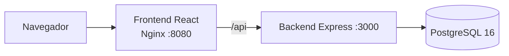
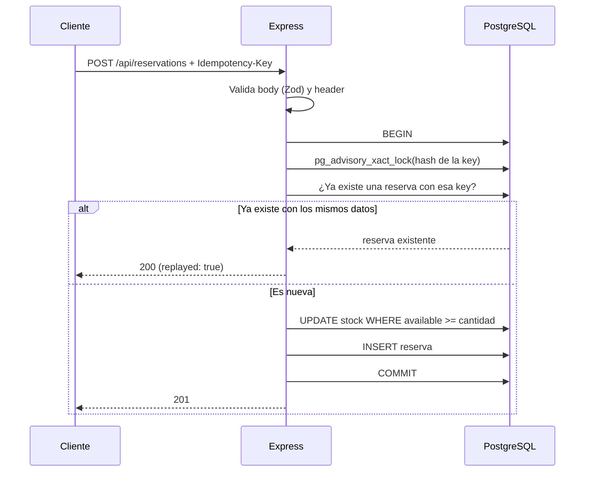

# API de reservas con inventario limitado

[](https://github.com/vzuliani97/mvp/actions/workflows/ci.yml)

Aplicación para reservar productos con inventario limitado. Está pensada para no vender de más cuando llegan solicitudes al mismo tiempo, y para que un reintento no descuente inventario dos veces.

*English: a reservation API with limited stock. It prevents overselling under concurrent requests and makes retries idempotent. Node.js/Express, PostgreSQL, React and Docker, with integration tests running in CI.*

## Stack

- **Backend:** Node.js 24, Express 5, Zod (validación), Pino (logs), Helmet
- **Base de datos:** PostgreSQL 16
- **Frontend:** React (Vite), servido con Nginx
- **Pruebas:** Vitest y Supertest contra PostgreSQL real
- **Infraestructura:** Docker multi-stage, Docker Compose, GitHub Actions

## Arquitectura



Flujo de una reserva:



## Ejecutar

```bash
cp .env.example .env
docker compose up --build
```

- Aplicación: http://localhost:8080
- Health check: http://localhost:8080/health

## Pruebas

```bash
make test
```

Las pruebas corren en GitHub Actions en cada push y en cada pull request.

Son 6 pruebas de integración contra la API real y PostgreSQL, enfocadas en los escenarios de mayor riesgo:

1. Solicitudes concurrentes sin sobreventa.
2. Repetir la misma operación no descuenta inventario dos veces.
3. Se puede reservar exactamente todo el inventario disponible.
4. Una `Idempotency-Key` no se puede reutilizar con datos diferentes.
5. Cancelar dos veces devuelve el inventario una sola vez.
6. El backend valida las cantidades aunque el cliente se salte el frontend.

## Decisiones principales

**Sin sobreventa bajo concurrencia.** El inventario se descuenta con un `UPDATE ... WHERE available_quantity >= cantidad` dentro de una transacción. La validación y el descuento ocurren en la misma sentencia, así que no queda una ventana entre leer y escribir. Además, un `CHECK (available_quantity >= 0)` en la tabla actúa como última defensa.

**Reintentos idempotentes.** Cada reserva requiere el header `Idempotency-Key`, guardado con una restricción `UNIQUE`. Si dos solicitudes llegan a la vez con la misma key, `pg_advisory_xact_lock` hace que la segunda espere a que termine la primera. Así recibe la misma reserva (200) en vez de crear otra. Si la key se reutiliza con datos diferentes, la API responde 409.

**Cancelación segura.** El inventario solo se devuelve cuando la reserva pasa de `ACTIVE` a `CANCELLED`. Una segunda cancelación no cambia nada y responde `replayed: true`.

**Trazabilidad.** Cada reserva es un registro independiente, aunque sea del mismo producto. Cada request lleva un `X-Request-Id` en los logs.

**Seguridad básica.** Validación estricta con Zod, límite de 10 KB en el body, cabeceras de Helmet, CORS restringido y el contenedor de producción corre como usuario sin privilegios.

## API

```text
GET  /health
GET  /api/products
GET  /api/reservations
POST /api/reservations              (header Idempotency-Key)
POST /api/reservations/:id/cancel
```

Crear una reserva:

```bash
curl -X POST http://localhost:8080/api/reservations \
  -H "Content-Type: application/json" \
  -H "Idempotency-Key: 7f9c2a1e-1111-4c1a-9a55-000000000001" \
  -d '{"productId": 1, "quantity": 2}'
```

Los errores tienen un formato uniforme:

```json
{ "error": { "code": "INSUFFICIENT_STOCK", "message": "Not enough inventory available", "details": { "availableQuantity": 1 } } }
```
